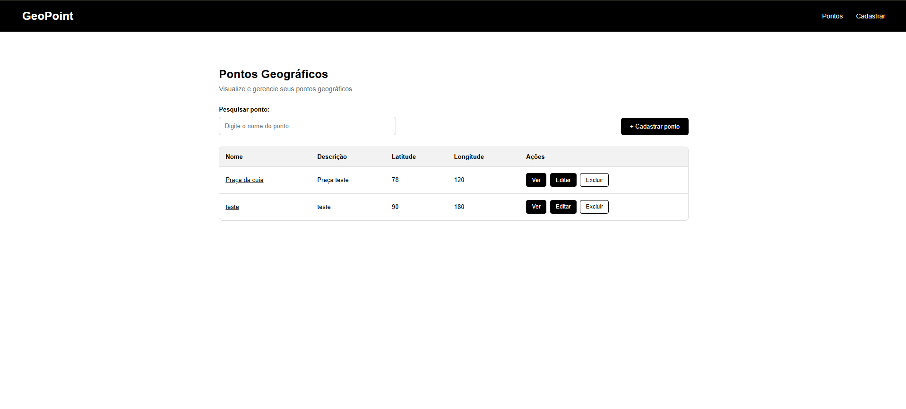
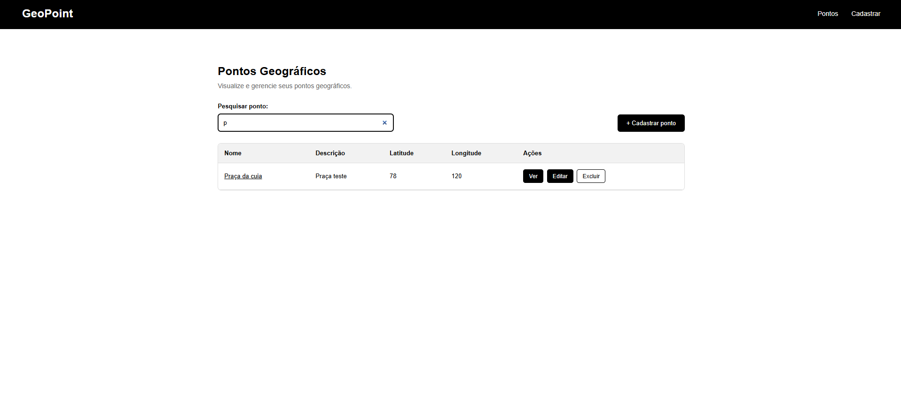
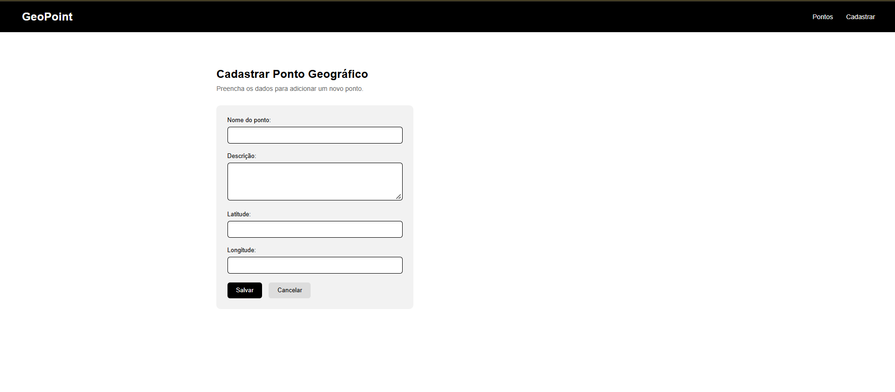
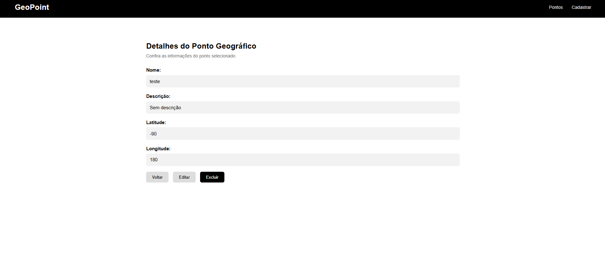
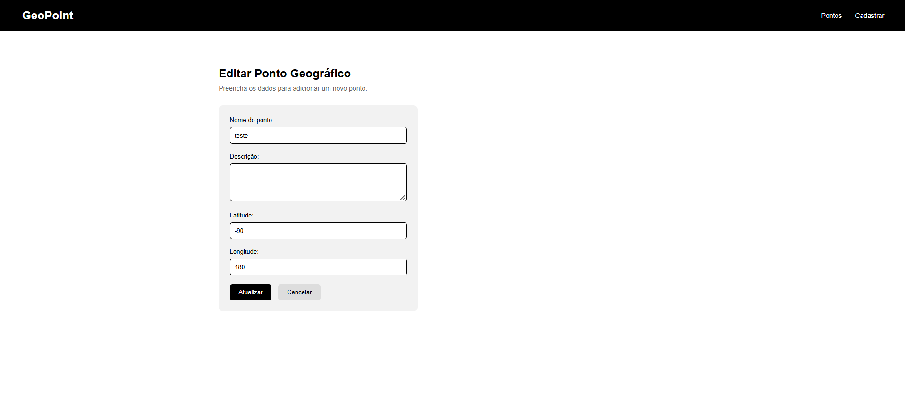

# GeoPoint - CRUD de Pontos Geográficos

Projeto desenvolvido para a disciplina de Desenvolvimento Frontend da ATITUS Educação.

## Sobre o projeto

O GeoPoint é uma aplicação web para cadastrar, visualizar, pesquisar, editar e excluir pontos geográficos, utilizando uma API REST.

## Funcionalidades

- Cadastro de pontos geográficos
- Listagem dos pontos cadastrados
- Pesquisa por nome
- Visualização dos detalhes de cada ponto
- Edição de pontos existentes
- Exclusão com confirmação
- Validação dos campos do formulário
- Mensagens de sucesso e erro
- Interface responsiva para computadores e celulares

## Tecnologias utilizadas

- HTML5
- CSS3
- JavaScript
- API REST
- Git e GitHub

## Como executar

1. Baixe ou clone este repositório.
2. Abra a pasta do projeto no Visual Studio Code.
3. Abra a pasta `CRUD DE pontos geograficos`.
4. Execute o arquivo `index.html` utilizando a extensão Live Server.
5. Aguarde o carregamento dos pontos pela API.

## API utilizada

https://geopoint-6x4u.onrender.com/api/points

## Integrantes

- Eloise Lima Pagnussat
- Allana Prestes

## Capturas de tela

### Tela inicial e listagem de pontos

### Pesquisa de pontos

### Cadastro de pontos

### Detalhes do ponto geográfico

### Edição de pontos

